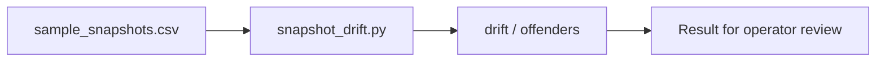

# Snapshot Drift Detector architecture

Compares expected and actual snapshot schedules to catch policy drift.

## Operational boundaries

The documented run evaluates the bundled sample locally. Results depend on the quality and scope of the input. The demo makes no live infrastructure changes.
